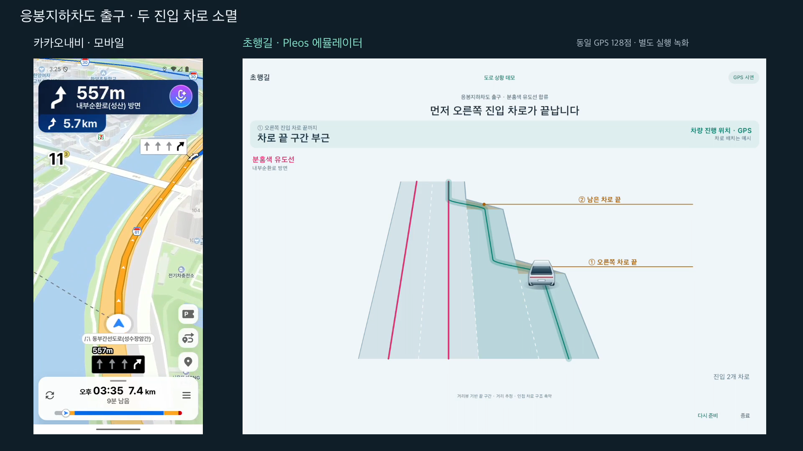
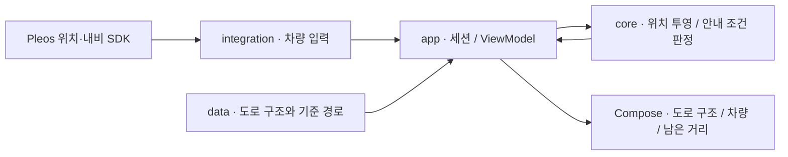

# 초행길

**처음 가는 길도, 아는 길처럼.**

초행길은 복잡한 합류와 진출 구간의 도로 구조를 미리 보여주는 차량용 안내 앱입니다.

진입 차로가 어디까지 이어지는지, 합류 직후 진출하려면 어느 구간에서 차선을 바꿀 수 있는지. 익숙한 운전자는 알고 있지만 초행길에서는 놓치기 쉬운 정보를 도로 모형과 차량의 움직임으로 보여줍니다. 기본 내비게이션과 함께 사용하는 보조 안내 앱입니다.

## 데모

[](demos/eungbong-two-lanes-v4/highlights.mp4)

| 구간 | 보여주는 정보 | 영상 |
|---|---|---|
| 응봉지하차도 출구 | 두 진입 차로가 순서대로 끝나는 구조와 각 끝까지 남은 거리 | [핵심 2분](demos/eungbong-two-lanes-v4/highlights.mp4) · [전체](demos/eungbong-two-lanes-v4/comparison.mp4) |
| 망원 합류·진출 | 합류 후 실선 구간과 차로 변경 가능한 구간을 구분해 가까운 진출 준비 | [핵심 1분 12초](demos/mangwon-short-exit-v1/highlights.mp4) · [전체](demos/mangwon-short-exit-v1/comparison.mp4) |

두 비교 영상은 각 사례의 동일 GPS 경로를 모바일 카카오내비와 우리 앱에 재생한 에뮬레이터 녹화입니다.

## 주요 기능

- **도로 구조 미리보기** — 이어지는 차로, 끝나는 차로, 합류와 진출의 관계를 한 화면에 표시합니다.
- **위치에 따른 안내** — 지정 구간에 접근하면 안내하고, 진행 위치에 맞춰 남은 거리를 갱신한 뒤 구간 통과 시 안내를 종료합니다.
- **차로 변경 구간 구분** — 실선으로 이동이 제한되는 부분과 이후 이동 가능한 부분을 나누어 보여줍니다.
- **정차 중 체험** — 차량 모형이 움직이는 시연으로 도로 구조를 살펴볼 수 있습니다.

현재는 응봉·망원 등 지정 구간을 검증하는 프로토타입입니다. 차로 끝은 거리뷰 관측 범위로 표시하며, 차량의 좌우 배치는 설명용 예시입니다. 현재 주행 차로나 주변 차량의 합류 가능 간격을 감지하지 않습니다.

## 아키텍처



| 모듈 | 역할 |
|---|---|
| `app` | Compose 화면·차량 모형, SDK 위치 맥락 조립, 안내 결과 표시, 세션·데모 흐름 |
| `core` | Android와 독립적인 위치 투영·진입/통과 판정 |
| `integration` | FusedLocation·NaviHelper·차량 UX 제한 읽기 |
| `data` | 도로 구조 데이터, 기준 경로, 출처와 검수 정보 |

**기술:** Kotlin · Jetpack Compose · Pleos FusedLocation / NaviHelper · Gradle

## 실행하기

JDK 17, Android SDK 35, Pleos Connect 에뮬레이터가 필요합니다.

1. Android Studio에서 이 저장소를 열고 Android SDK 경로를 설정합니다.
2. 아래 명령으로 debug APK를 빌드합니다. 첫 실행에는 의존성 다운로드가 필요합니다.
3. Android Studio에서 `app`을 선택해 Pleos 에뮬레이터에 실행합니다.
4. 권한 설정을 마친 뒤 정차 상태에서 **도로 상황 데모**를 열고 **응봉 분홍색 합류** 또는 **망원 실선·점선**을 선택합니다.

```sh
./gradlew :app:assembleDebug
```

APK: `app/build/outputs/apk/debug/app-debug.apk`

```sh
# 위치 판정 및 앱 로직 테스트
./gradlew :core:test :app:testDebugUnitTest
```

## 더 알아보기

- [제품 기획](docs/road-context-helper-plan.md)
- [화면 설계](DESIGN.md)
- [SDK 연동 설계](docs/decisions/sdk.md)
- [빌드 환경과 저장소 설정](docs/repository-setup.md)
- [개발·검증 기록](docs/development-notes-20261115.md)
